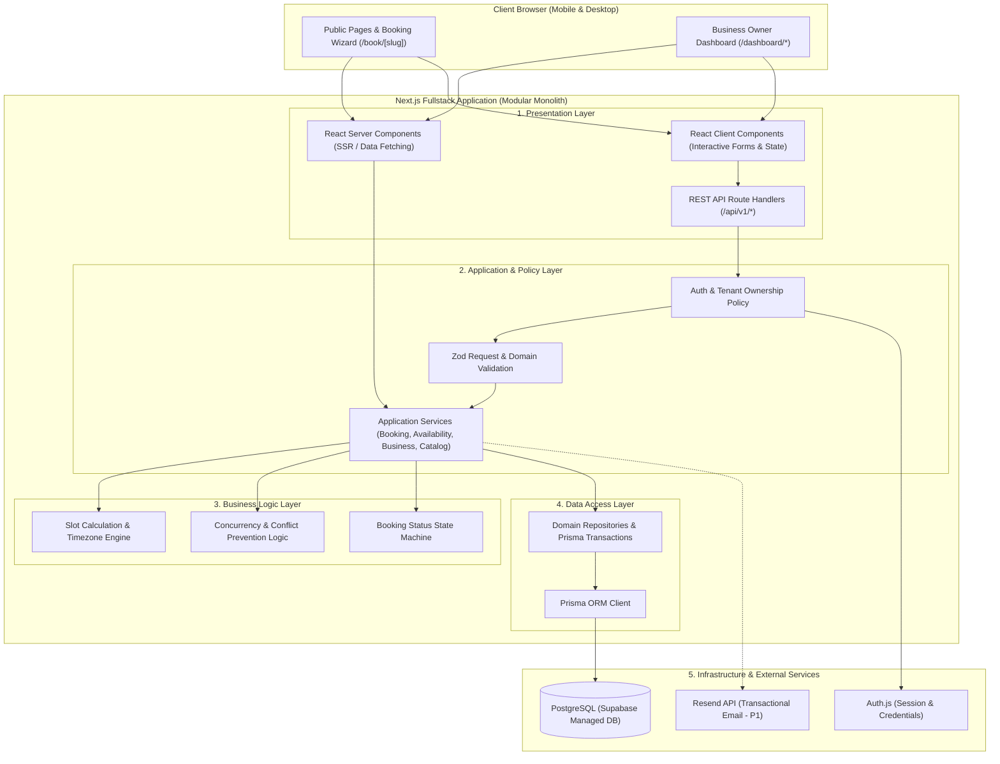
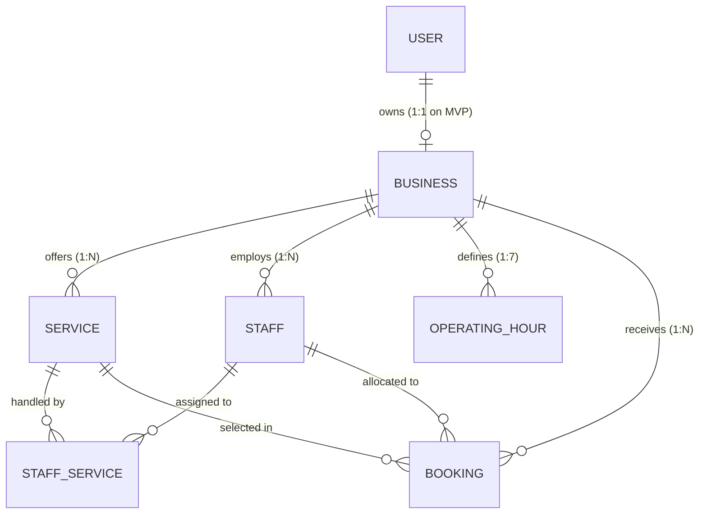
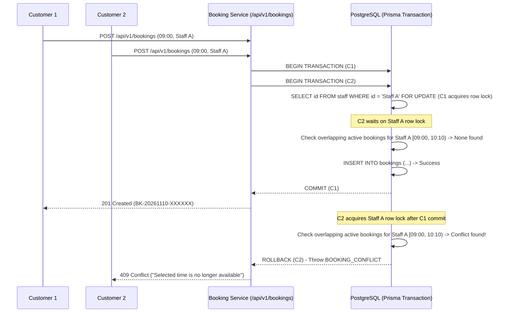
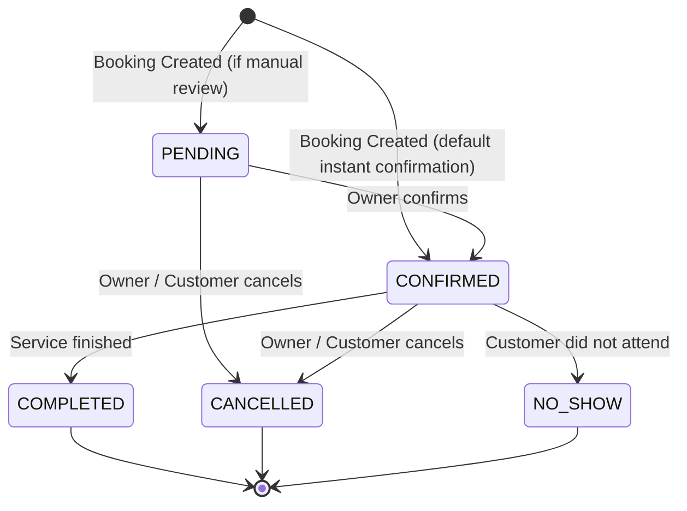

# TECHNICAL_PLAN.md — BookEase Architecture & Technical Specification

**Project:** BookEase — Online Booking (Anything Consult, Clinic, etc) & Appointment Management SaaS  
**Version:** 1.0.0  
**Phase:** Phase 2 — Technical Planning & Architecture  
**Architecture Style:** Pragmatic Modular Monolith (Next.js App Router Fullstack)  
**Database:** PostgreSQL (via Prisma ORM)  

---

## 1. Architecture Overview

BookEase dibangun menggunakan arsitektur **Modular Monolith** di atas **Next.js App Router (TypeScript)**. Seluruh layer—mulai dari UI publik, dashboard pemilik bisnis, REST API (`Route Handlers`), business logic, hingga akses database—berada dalam satu repositori terpadu dengan batas tanggung jawab (separation of concerns) yang tegas.

### 1.1 Diagram Arsitektur Sistem



### 1.2 Tanggung Jawab Setiap Layer

| Layer | Lokasi Utama | Tanggung Jawab Utama | Aturan Ketergantungan |
| :--- | :--- | :--- | :--- |
| **1. Presentation Layer** | `src/app/`, `src/components/`, `src/features/*/components/` | Merender halaman (RSC), menangani interaksi form (RCC), serta menerima HTTP request melalui Route Handlers (`/api/v1/*`). | Boleh memanggil Application Layer (`src/server/services/`) dan validasi (`src/lib/validations/`). Tidak boleh memanggil query Prisma secara langsung dari komponen UI. |
| **2. Application Layer** | `src/server/services/`, `src/server/policies/` | Mengorkestrasi use case bisnis (mis. `createBooking`, `getAvailableSlots`), memeriksa otorisasi kepemilikan bisnis (`policies`), dan mengelola batas transaksi database. | Memanggil Business Logic Layer, Data Access Layer, dan Infrastructure adapters. |
| **3. Business Logic Layer** | `src/features/*/utils/`, `src/server/services/slot-engine.ts` | Menerapkan aturan domain murni: kalkulasi slot waktu, konversi timezone bisnis ke UTC, deteksi overlap jadwal, dan aturan transisi status booking. | Murni TypeScript (pure functions/domain modules). **Tidak boleh** bergantung pada React atau objek HTTP Next.js. |
| **4. Data Access Layer** | `src/server/repositories/`, `prisma/` | Menjalankan query CRUD, relasi, locking transaksional (`$transaction`), dan pemetaan entitas PostgreSQL melalui Prisma ORM. | Hanya berinteraksi dengan `src/lib/prisma.ts` dan tipe domain. Wajib menyertakan filter `businessId` untuk isolasi multi-tenant. |
| **5. Infrastructure Layer** | `src/lib/prisma.ts`, `src/lib/auth.ts`, `src/lib/email.ts`, `src/lib/rate-limit.ts` | Mengelola koneksi singleton Prisma, konfigurasi Auth.js, pengiriman email (Resend), logging, dan rate limiting. | Menyediakan interface/utilitas teknis bagi Application Layer. |

---

## 2. Folder Structure

Struktur direktori final BookEase dirancang agar modular, mudah dinavigasi oleh solo developer, dan mendukung pertumbuhan fitur dari MVP hingga P1/P2:

```text
bookease/
├── prisma/
│   ├── schema.prisma                # Definisi skema PostgreSQL & Prisma
│   ├── seed.ts                      # Data awal development/testing
│   └── migrations/                  # Riwayat migrasi SQL terkelola (termasuk btree_gist)
│
├── public/                          # Aset statis publik
│
├── src/
│   ├── app/
│   │   ├── (marketing)/             # Public landing pages
│   │   │   ├── layout.tsx
│   │   │   ├── page.tsx             # / (Homepage)
│   │   │   ├── features/page.tsx    # /features
│   │   │   ├── pricing/page.tsx     # /pricing
│   │   │   ├── privacy/page.tsx     # /privacy
│   │   │   └── terms/page.tsx       # /terms
│   │   │
│   │   ├── (auth)/                  # Authentication pages
│   │   │   ├── layout.tsx
│   │   │   ├── login/page.tsx       # /login
│   │   │   └── register/page.tsx    # /register
│   │   │
│   │   ├── (dashboard)/             # Protected business owner workspace
│   │   │   └── dashboard/
│   │   │       ├── layout.tsx
│   │   │       ├── page.tsx                 # /dashboard (Overview & stats)
│   │   │       ├── business/page.tsx        # /dashboard/business
│   │   │       ├── services/page.tsx        # /dashboard/services
│   │   │       ├── staff/page.tsx           # /dashboard/staff
│   │   │       ├── schedule/page.tsx        # /dashboard/schedule
│   │   │       ├── bookings/page.tsx        # /dashboard/bookings
│   │   │       ├── bookings/[id]/page.tsx   # /dashboard/bookings/[id]
│   │   │       └── settings/page.tsx        # /dashboard/settings
│   │   │
│   │   ├── book/                    # Public customer booking flow
│   │   │   └── [slug]/
│   │   │       ├── page.tsx                 # /book/[slug] (Booking wizard)
│   │   │       └── success/page.tsx         # /book/[slug]/success
│   │   │
│   │   ├── api/
│   │   │   ├── auth/[...nextauth]/route.ts  # Auth.js handler
│   │   │   └── v1/
│   │   │       ├── auth/register/route.ts
│   │   │       ├── business/route.ts
│   │   │       ├── businesses/[slug]/route.ts
│   │   │       ├── services/route.ts
│   │   │       ├── services/[id]/route.ts
│   │   │       ├── staff/route.ts
│   │   │       ├── staff/[id]/route.ts
│   │   │       ├── schedule/route.ts
│   │   │       ├── availability/route.ts
│   │   │       ├── bookings/route.ts
│   │   │       └── bookings/[id]/route.ts
│   │   │
│   │   ├── globals.css
│   │   └── layout.tsx
│   │
│   ├── components/
│   │   ├── ui/                      # Komponen dasar shadcn/ui
│   │   ├── shared/                  # StatusBadge, EmptyState, LoadingState, ErrorState, ConfirmDialog
│   │   ├── marketing/               # Navbar, Footer, Hero, FeatureGrid
│   │   ├── dashboard/               # DashboardSidebar, DashboardHeader, StatCard
│   │   └── booking/                 # BookingWizard, DatePicker, TimeSlotPicker, BookingSummary
│   │
│   ├── features/
│   │   ├── auth/                    # Form login/register, hooks, types
│   │   ├── business/                # Form profil bisnis & pengaturan slug/timezone
│   │   ├── services/                # ServiceCard, ServiceForm, service hooks
│   │   ├── staff/                   # StaffCard, StaffForm, staff assignment UI
│   │   ├── schedule/                # OperatingHoursForm, pengaturan hari buka/tutup
│   │   └── bookings/                # BookingTable, BookingCard, filter & status actions
│   │
│   ├── lib/
│   │   ├── prisma.ts                # PrismaClient singleton instance
│   │   ├── auth.ts                  # Konfigurasi Auth.js
│   │   ├── api-response.ts          # Helper response standar API (success/error envelope)
│   │   ├── errors.ts                # Class AppError & pemetaan kode error
│   │   ├── timezone.ts              # Utilitas konversi UTC <-> Business Timezone
│   │   ├── rate-limit.ts            # Rate limiter untuk endpoint publik & autentikasi
│   │   ├── validations/             # Skema Zod bersama (shared server & client)
│   │   │   ├── auth.schema.ts
│   │   │   ├── business.schema.ts
│   │   │   ├── service.schema.ts
│   │   │   ├── staff.schema.ts
│   │   │   ├── schedule.schema.ts
│   │   │   └── booking.schema.ts
│   │   └── utils.ts
│   │
│   ├── server/
│   │   ├── policies/
│   │   │   └── auth-policy.ts       # requireSession(), requireBusinessOwner()
│   │   ├── repositories/
│   │   │   ├── user.repository.ts
│   │   │   ├── business.repository.ts
│   │   │   ├── service.repository.ts
│   │   │   ├── staff.repository.ts
│   │   │   ├── schedule.repository.ts
│   │   │   └── booking.repository.ts
│   │   └── services/
│   │       ├── auth.service.ts
│   │       ├── business.service.ts
│   │       ├── service.service.ts
│   │       ├── staff.service.ts
│   │       ├── schedule.service.ts
│   │       ├── availability.service.ts
│   │       └── booking.service.ts
│   │
│   ├── hooks/                       # Custom React hooks umum
│   ├── stores/                      # Zustand store (khusus state wizard/UI lintas komponen)
│   ├── types/                       # Kontrak TypeScript global & DTO
│   └── constants/                   # Daftar timezone, kategori bisnis, status transisi
│
├── PROJECT_PRD_AND_PLAYBOOK.md
├── TECHNICAL_PLAN.md
├── package.json
└── tsconfig.json
```

---

## 3. Data Model & Prisma Schema Design

### 3.1 Spesifikasi Skema Prisma (`prisma/schema.prisma`)

```prisma
generator client {
  provider = "prisma-client-js"
}

datasource db {
  provider  = "postgresql"
  url       = env("DATABASE_URL")
  directUrl = env("DIRECT_URL")
}

enum BookingStatus {
  PENDING
  CONFIRMED
  CANCELLED
  COMPLETED
  NO_SHOW
}

model User {
  id           String    @id @default(cuid())
  name         String
  email        String    @unique
  passwordHash String
  createdAt    DateTime  @default(now()) @db.Timestamptz(3)
  updatedAt    DateTime  @updatedAt @db.Timestamptz(3)

  business     Business?

  @@index([email])
  @@map("users")
}

model Business {
  id                String          @id @default(cuid())
  ownerId           String          @unique
  name              String
  slug              String          @unique
  category          String          @default("General")
  description       String?         @db.Text
  address           String?         @db.Text
  phone             String?
  logoUrl           String?
  timezone          String          @default("Asia/Jakarta")
  bufferTimeMinutes Int             @default(0)
  createdAt         DateTime        @default(now()) @db.Timestamptz(3)
  updatedAt         DateTime        @updatedAt @db.Timestamptz(3)

  owner             User            @relation(fields: [ownerId], references: [id], onDelete: Cascade)
  services          Service[]
  staff             Staff[]
  operatingHours    OperatingHour[]
  bookings          Booking[]

  @@index([slug])
  @@index([ownerId])
  @@map("businesses")
}

model Service {
  id              String         @id @default(cuid())
  businessId      String
  name            String
  description     String?        @db.Text
  price           Int            // Disimpan dalam satuan mata uang terkecil / Rupiah bulat (mis. 150000)
  durationMinutes Int            // Durasi layanan dalam menit (> 0)
  isActive        Boolean        @default(true)
  createdAt       DateTime       @default(now()) @db.Timestamptz(3)
  updatedAt       DateTime       @updatedAt @db.Timestamptz(3)

  business        Business       @relation(fields: [businessId], references: [id], onDelete: Cascade)
  staffServices   StaffService[]
  bookings        Booking[]

  @@index([businessId, isActive])
  @@map("services")
}

model Staff {
  id            String         @id @default(cuid())
  businessId    String
  name          String
  roleOrTitle   String?
  bio           String?        @db.Text
  isActive      Boolean        @default(true)
  createdAt     DateTime       @default(now()) @db.Timestamptz(3)
  updatedAt     DateTime       @updatedAt @db.Timestamptz(3)

  business      Business       @relation(fields: [businessId], references: [id], onDelete: Cascade)
  staffServices StaffService[]
  bookings      Booking[]

  @@index([businessId, isActive])
  @@map("staff")
}

model StaffService {
  staffId   String
  serviceId String
  assignedAt DateTime @default(now()) @db.Timestamptz(3)

  staff     Staff     @relation(fields: [staffId], references: [id], onDelete: Cascade)
  service   Service   @relation(fields: [serviceId], references: [id], onDelete: Cascade)

  @@id([staffId, serviceId])
  @@index([serviceId])
  @@map("staff_services")
}

model OperatingHour {
  id         String   @id @default(cuid())
  businessId String
  dayOfWeek  Int      // 0 = Minggu, 1 = Senin, ..., 6 = Sabtu
  openTime   String   // Format "HH:mm" (24 jam, mis. "09:00")
  closeTime  String   // Format "HH:mm" (24 jam, mis. "18:00")
  isClosed   Boolean  @default(false)
  createdAt  DateTime @default(now()) @db.Timestamptz(3)
  updatedAt  DateTime @updatedAt @db.Timestamptz(3)

  business   Business @relation(fields: [businessId], references: [id], onDelete: Cascade)

  @@unique([businessId, dayOfWeek])
  @@index([businessId])
  @@map("operating_hours")
}

model Booking {
  id                      String        @id @default(cuid())
  reference               String        @unique // Contoh: "BK-20261105-8F92A1"
  businessId              String
  serviceId               String
  staffId                 String
  customerName            String
  customerEmail           String
  customerPhone           String
  customerNotes           String?       @db.Text
  serviceNameSnapshot     String        // Snapshot nama layanan saat booking dibuat
  servicePriceSnapshot    Int           // Snapshot harga layanan saat booking dibuat
  durationMinutesSnapshot Int           // Snapshot durasi layanan saat booking dibuat
  bufferMinutesSnapshot   Int           @default(0)
  startAt                 DateTime      @db.Timestamptz(3) // Disimpan dalam UTC
  endAt                   DateTime      @db.Timestamptz(3) // Disimpan dalam UTC (startAt + durationMinutesSnapshot)
  occupiedEndAt           DateTime      @db.Timestamptz(3) // Disimpan dalam UTC (endAt + bufferMinutesSnapshot)
  status                  BookingStatus @default(PENDING)
  cancelledAt             DateTime?     @db.Timestamptz(3)
  cancelReason            String?
  createdAt               DateTime      @default(now()) @db.Timestamptz(3)
  updatedAt               DateTime      @updatedAt @db.Timestamptz(3)

  business                Business      @relation(fields: [businessId], references: [id], onDelete: Cascade)
  service                 Service       @relation(fields: [serviceId], references: [id], onDelete: Restrict)
  staff                   Staff         @relation(fields: [staffId], references: [id], onDelete: Restrict)

  @@index([businessId, startAt])
  @@index([businessId, status])
  @@index([staffId, startAt, occupiedEndAt])
  @@index([reference])
  @@map("bookings")
}
```

### 3.2 Keputusan Penting Desain Data

1. **Snapshot Historis pada `Booking`**:
   - Menyimpan `serviceNameSnapshot`, `servicePriceSnapshot`, `durationMinutesSnapshot`, dan `bufferMinutesSnapshot` saat reservasi dibuat. Jika pemilik bisnis mengubah harga atau durasi layanan di kemudian hari, histori booking lama tetap akurat (memenuhi aturan 13.3 PRD).
2. **`occupiedEndAt` untuk Buffer Time**:
   - `endAt` merepresentasikan waktu selesai layanan pelanggan (`startAt + durationMinutesSnapshot`).
   - `occupiedEndAt` merepresentasikan akhir waktu blokir staf termasuk jeda antar-reservasi (`endAt + bufferMinutesSnapshot`). Pengecekan benturan jadwal menggunakan rentang `[startAt, occupiedEndAt)`.
3. **Soft Deactivation & Non-Destructive Cancellation**:
   - Layanan (`Service`) dan Staf (`Staff`) memiliki flag `isActive` dan relasi `onDelete: Restrict` terhadap `Booking` agar penghapusan/penonaktifan tidak merusak histori reservasi.
   - Pembatalan reservasi hanya mengubah `status = CANCELLED` dan mengisi `cancelledAt`, tidak pernah melakukan `DELETE` pada tabel `bookings`.

---

## 4. Database Relationships



### Aturan Integritas Relasional
- **`User` ↔ `Business`**: Satu `User` (Business Owner) memiliki tepat satu workspace `Business` pada MVP (`ownerId @unique`), namun seluruh tabel anak (`services`, `staff`, `operating_hours`, `bookings`) mengacu pada `businessId` sehingga siap diekspansi ke multi-business/multi-branch di masa depan.
- **`Staff` ↔ `Service` (`StaffService`)**: Relasi Many-to-Many eksplisit. Hanya staf yang memiliki `isActive = true` dan terdaftar pada `StaffService` untuk `serviceId` terkait yang dapat menerima booking layanan tersebut.
- **`Business` ↔ `OperatingHour`**: Setiap bisnis memiliki tepat 7 baris `OperatingHour` (`dayOfWeek` `0` s/d `6`) dengan constraint `@@unique([businessId, dayOfWeek])` yang diinisialisasi otomatis saat bisnis dibuat.

---

## 5. API Contracts

Seluruh endpoint REST API berada di bawah prefix `/api/v1` dan menggunakan format respons standar (lihat Bagian 10).

### 5.1 Ringkasan Endpoint

| Method | Endpoint | Auth | Deskripsi |
| :--- | :--- | :--- | :--- |
| `POST` | `/api/v1/auth/register` | Public | Registrasi akun pemilik bisnis & inisialisasi workspace bisnis default |
| `GET` | `/api/v1/business` | Owner | Mengambil profil bisnis milik pengguna yang sedang login |
| `PATCH` | `/api/v1/business` | Owner | Memperbarui profil bisnis, slug, timezone, dan buffer time |
| `GET` | `/api/v1/businesses/[slug]` | Public | Mengambil profil bisnis publik, layanan aktif, staf aktif, dan jam buka |
| `GET` | `/api/v1/services` | Owner | Mengambil seluruh daftar layanan (aktif & nonaktif) milik bisnis |
| `POST` | `/api/v1/services` | Owner | Membuat layanan baru beserta relasi `staffIds` |
| `PATCH` | `/api/v1/services/[id]` | Owner | Mengubah detail layanan, status `isActive`, atau penugasan staf |
| `DELETE` | `/api/v1/services/[id]` | Owner | Menonaktifkan layanan (atau menghapus jika belum memiliki booking) |
| `GET` | `/api/v1/staff` | Owner | Mengambil seluruh daftar staf milik bisnis beserta layanan yang ditangani |
| `POST` | `/api/v1/staff` | Owner | Menambahkan staf baru dan menghubungkannya ke layanan (`serviceIds`) |
| `PATCH` | `/api/v1/staff/[id]` | Owner | Memperbarui data staf, status `isActive`, dan penugasan layanan |
| `GET` | `/api/v1/schedule` | Owner | Mengambil jadwal operasional mingguan (7 hari) milik bisnis |
| `PUT` | `/api/v1/schedule` | Owner | Memperbarui jadwal operasional mingguan bisnis secara sekaligus |
| `GET` | `/api/v1/availability` | Public | Menghitung daftar slot waktu yang tersedia pada tanggal & layanan tertentu |
| `POST` | `/api/v1/bookings` | Public | Membuat reservasi baru secara transaksional (anti-double-booking) |
| `GET` | `/api/v1/bookings` | Owner | Mengambil daftar reservasi bisnis (mendukung filter tanggal, status, search, pagination) |
| `GET` | `/api/v1/bookings/[id]` | Owner | Mengambil detail lengkap satu reservasi milik bisnis |
| `PATCH` | `/api/v1/bookings/[id]` | Owner | Mengubah status reservasi (`CONFIRMED`, `CANCELLED`, `COMPLETED`, `NO_SHOW`) |

---

### 5.2 Spesifikasi Detail Kontrak API Utama

#### 1. `POST /api/v1/auth/register`
- **Auth**: Public (Rate-limited)
- **Request Payload**:
  ```json
  {
    "name": "Budi Santoso",
    "email": "budi@glowstudio.id",
    "password": "Password123!",
    "businessName": "Glow Beauty Studio",
    "businessSlug": "glow-beauty-studio",
    "timezone": "Asia/Jakarta"
  }
  ```
- **Validation (Zod)**:
  - `name`: string, min 2, max 100.
  - `email`: valid email, lowercase, unique.
  - `password`: min 8 karakter, minimal 1 huruf & 1 angka.
  - `businessName`: string, min 2, max 100.
  - `businessSlug`: regex `^[a-z0-9]+(?:-[a-z0-9]+)*$`, min 3, max 60, bukan reserved word.
  - `timezone`: valid IANA timezone (`Asia/Jakarta`, `Asia/Makassar`, `Asia/Jayapura`, dll.).
- **Response (`201 Created`)**:
  ```json
  {
    "success": true,
    "data": {
      "user": { "id": "usr_1", "name": "Budi Santoso", "email": "budi@glowstudio.id" },
      "business": { "id": "biz_1", "name": "Glow Beauty Studio", "slug": "glow-beauty-studio", "timezone": "Asia/Jakarta" }
    },
    "message": "Account and business registered successfully"
  }
  ```
- **Error Codes**: `VALIDATION_ERROR (400)`, `EMAIL_ALREADY_EXISTS (409)`, `SLUG_ALREADY_EXISTS (409)`, `RATE_LIMIT_EXCEEDED (429)`.

---

#### 2. `GET /api/v1/business` & `PATCH /api/v1/business`
- **Auth**: Authenticated Business Owner
- **Request Payload (`PATCH`)**:
  ```json
  {
    "name": "Glow Beauty Studio",
    "slug": "glow-beauty-studio",
    "category": "Beauty & Salon",
    "description": "Perawatan wajah dan rambut profesional.",
    "address": "Jl. Sudirman No. 45, Jakarta",
    "phone": "+6281234567890",
    "timezone": "Asia/Jakarta",
    "bufferTimeMinutes": 10
  }
  ```
- **Error Codes**: `UNAUTHORIZED (401)`, `VALIDATION_ERROR (400)`, `SLUG_ALREADY_EXISTS (409)`.

---

#### 3. `GET /api/v1/businesses/[slug]`
- **Auth**: Public
- **Behavior**: Mengembalikan informasi publik bisnis, daftar layanan dengan `isActive: true`, daftar staf dengan `isActive: true`, serta `operatingHours`. **Tidak pernah** mengembalikan `ownerId`, email owner, atau data booking pelanggan.
- **Error Codes**: `BUSINESS_NOT_FOUND (404)`.

---

#### 4. `GET /api/v1/services`, `POST /api/v1/services`, `PATCH /api/v1/services/[id]`, `DELETE /api/v1/services/[id]`
- **Auth**: Authenticated Business Owner
- **Request Payload (`POST` / `PATCH`)**:
  ```json
  {
    "name": "Signature Facial Treatment",
    "description": "Pembersihan mendalam dan serum vitamin C.",
    "price": 250000,
    "durationMinutes": 60,
    "isActive": true,
    "staffIds": ["stf_1", "stf_2"]
  }
  ```
- **Validation**:
  - `price`: integer `>= 0`.
  - `durationMinutes`: integer `>= 5` dan `<= 480`.
  - `staffIds`: array ID staf yang wajib milik `businessId` yang sama.
- **Error Codes**: `UNAUTHORIZED (401)`, `FORBIDDEN (403)`, `SERVICE_NOT_FOUND (404)`, `VALIDATION_ERROR (400)`.

---

#### 5. `GET /api/v1/staff`, `POST /api/v1/staff`, `PATCH /api/v1/staff/[id]`
- **Auth**: Authenticated Business Owner
- **Request Payload (`POST` / `PATCH`)**:
  ```json
  {
    "name": "Siti Rahma",
    "roleOrTitle": "Senior Aesthetician",
    "bio": "Berpengalaman 5 tahun dalam perawatan kulit.",
    "isActive": true,
    "serviceIds": ["srv_1", "srv_2"]
  }
  ```
- **Validation**: `serviceIds` wajib milik `businessId` yang sama.
- **Error Codes**: `UNAUTHORIZED (401)`, `FORBIDDEN (403)`, `STAFF_NOT_FOUND (404)`, `VALIDATION_ERROR (400)`.

---

#### 6. `GET /api/v1/schedule` & `PUT /api/v1/schedule`
- **Auth**: Authenticated Business Owner
- **Request Payload (`PUT`)**:
  ```json
  {
    "schedule": [
      { "dayOfWeek": 0, "openTime": "09:00", "closeTime": "17:00", "isClosed": true },
      { "dayOfWeek": 1, "openTime": "09:00", "closeTime": "18:00", "isClosed": false },
      { "dayOfWeek": 2, "openTime": "09:00", "closeTime": "18:00", "isClosed": false },
      { "dayOfWeek": 3, "openTime": "09:00", "closeTime": "18:00", "isClosed": false },
      { "dayOfWeek": 4, "openTime": "09:00", "closeTime": "18:00", "isClosed": false },
      { "dayOfWeek": 5, "openTime": "09:00", "closeTime": "18:00", "isClosed": false },
      { "dayOfWeek": 6, "openTime": "10:00", "closeTime": "16:00", "isClosed": false }
    ]
  }
  ```
- **Validation**:
  - Harus mencakup tepat 7 hari (`dayOfWeek` `0..6`).
  - Format `openTime` & `closeTime`: `^([01]\d|2[0-3]):([0-5]\d)$`.
  - Jika `isClosed === false`, maka `closeTime` wajib lebih besar daripada `openTime`.

---

#### 7. `GET /api/v1/availability`
- **Auth**: Public (Rate-limited)
- **Query Parameters**:
  - `slug` (required): slug bisnis, mis. `glow-beauty-studio`
  - `serviceId` (required): ID layanan yang dipilih
  - `date` (required): Tanggal dalam timezone bisnis, format `YYYY-MM-DD`, mis. `2026-11-10`
  - `staffId` (optional): ID staf spesifik. Jika tidak dikirim atau bernilai `"any"`, sistem menggabungkan ketersediaan dari seluruh staf aktif yang ditugaskan pada layanan tersebut.
- **Response (`200 OK`)**:
  ```json
  {
    "success": true,
    "data": {
      "date": "2026-11-10",
      "timezone": "Asia/Jakarta",
      "serviceDurationMinutes": 60,
      "bufferTimeMinutes": 10,
      "isClosed": false,
      "slots": [
        {
          "time": "09:00",
          "startAt": "2026-11-10T02:00:00.000Z",
          "endAt": "2026-11-10T03:00:00.000Z",
          "availableStaffIds": ["stf_1", "stf_2"]
        },
        {
          "time": "09:30",
          "startAt": "2026-11-10T02:30:00.000Z",
          "endAt": "2026-11-10T03:30:00.000Z",
          "availableStaffIds": ["stf_2"]
        }
      ]
    },
    "message": "Available slots retrieved"
  }
  ```
- **Error Codes**: `VALIDATION_ERROR (400)`, `BUSINESS_NOT_FOUND (404)`, `SERVICE_UNAVAILABLE (400)`.

---

#### 8. `POST /api/v1/bookings`
- **Auth**: Public (Rate-limited)
- **Request Payload**:
  ```json
  {
    "businessSlug": "glow-beauty-studio",
    "serviceId": "srv_1",
    "staffId": "stf_1",
    "date": "2026-11-10",
    "time": "09:00",
    "customerName": "Andi Pratama",
    "customerEmail": "andi@example.com",
    "customerPhone": "+6281122334455",
    "customerNotes": "Mohon gunakan produk khusus kulit sensitif."
  }
  ```
  *(Catatan: `staffId` boleh bernilai `null` / `"any"` jika pelanggan memilih opsi "Any Available Staff")*.
- **Response (`201 Created`)**:
  ```json
  {
    "success": true,
    "data": {
      "id": "bkg_1",
      "reference": "BK-20261110-9X4K2P",
      "status": "CONFIRMED",
      "businessName": "Glow Beauty Studio",
      "serviceName": "Signature Facial Treatment",
      "staffName": "Siti Rahma",
      "startAt": "2026-11-10T02:00:00.000Z",
      "endAt": "2026-11-10T03:00:00.000Z",
      "timezone": "Asia/Jakarta"
    },
    "message": "Booking created successfully"
  }
  ```
- **Error Codes**: `VALIDATION_ERROR (400)`, `BUSINESS_NOT_FOUND (404)`, `SERVICE_UNAVAILABLE (400)`, `SLOT_UNAVAILABLE (409)`, `BOOKING_CONFLICT (409)`, `RATE_LIMIT_EXCEEDED (429)`.

---

#### 9. `GET /api/v1/bookings`, `GET /api/v1/bookings/[id]`, `PATCH /api/v1/bookings/[id]`
- **Auth**: Authenticated Business Owner
- **Query Params (`GET /api/v1/bookings`)**:
  - `status` (optional): `PENDING | CONFIRMED | CANCELLED | COMPLETED | NO_SHOW`
  - `dateFrom`, `dateTo` (optional): filter rentang tanggal (`YYYY-MM-DD`)
  - `search` (optional): pencarian berdasarkan `customerName`, `customerEmail`, `customerPhone`, atau `reference`
  - `page` (default `1`), `limit` (default `20`, max `100`)
- **Request Payload (`PATCH /api/v1/bookings/[id]`)**:
  ```json
  {
    "status": "CANCELLED",
    "cancelReason": "Pelanggan meminta reschedule melalui telepon."
  }
  ```
- **Error Codes**: `UNAUTHORIZED (401)`, `FORBIDDEN (403)`, `BOOKING_NOT_FOUND (404)`, `INVALID_STATUS_TRANSITION (400)`.

---

## 6. Authentication Strategy

BookEase menggunakan **Auth.js (NextAuth v5)** dengan **Credentials Provider** untuk autentikasi Business Owner. Pelanggan publik **tidak memerlukan akun** untuk melakukan reservasi.

### 6.1 Mekanisme Autentikasi
1. **Password Hashing**:
   - Menggunakan `bcryptjs` dengan salt cost factor `12` (kompatibel penuh dengan Node.js runtime di Vercel dan lingkungan lokal).
   - Password tidak pernah disimpan dalam bentuk plaintext dan `passwordHash` selalu dikecualikan dari seluruh DTO respons.
2. **Session Strategy**:
   - Menggunakan strategi **JWT di dalam HTTP-Only, Secure, SameSite=Lax Cookie**.
   - Payload token JWT dan objek `session.user` diperkaya dengan:
     - `user.id`: ID pengguna (`User.id`)
     - `user.email`: Email pengguna
     - `user.name`: Nama pengguna
     - `user.businessId`: ID bisnis milik pengguna (`Business.id`)
     - `user.businessSlug`: Slug bisnis (`Business.slug`)
3. **Proteksi Route**:
   - Layout `/dashboard/*` memeriksa session di sisi server (`auth()`). Jika tidak ada session aktif, pengguna langsung diarahkan (`redirect("/login")`).
   - Halaman `/login` dan `/register` mengalihkan pengguna yang sudah login ke `/dashboard`.

---

## 7. Authorization & Multi-Tenant Data Isolation

Keamanan multi-tenant BookEase bertumpu pada prinsip **Zero Trust terhadap Client Input**:

1. **Verifikasi Session & Kepemilikan Bisnis (`requireBusinessOwner`)**:
   - Setiap request ke endpoint dashboard (`/api/v1/business`, `/api/v1/services`, `/api/v1/staff`, `/api/v1/schedule`, `/api/v1/bookings`) wajib melewati helper server `requireBusinessOwner()`.
   - Helper ini mengambil `session` dari server dan memastikan `businessId` yang terkait dengan `session.user.id` valid di database.
2. **Isolasi Query Berbasis `businessId`**:
   - Seluruh method pada repository (`service.repository.ts`, `staff.repository.ts`, `booking.repository.ts`) **wajib** menerima parameter `businessId` dari session server (bukan dari body/query request) dan menyertakannya pada klausa `WHERE`:
     ```ts
     // Contoh pola query wajib:
     prisma.booking.findFirst({
       where: { id: bookingId, businessId: ownerBusiness.id }
     });
     ```
3. **Pencegahan IDOR (Insecure Direct Object Reference)**:
   - Jika Owner A mencoba mengakses atau mengubah `/api/v1/bookings/[id_milik_owner_B]` atau `/api/v1/services/[id_milik_owner_B]`, query dengan filter `{ id, businessId: ownerA.businessId }` tidak akan menemukan record dan mengembalikan `404 Not Found` / `403 Forbidden`.
   - Saat menugaskan `staffIds` ke sebuah `Service` (atau sebaliknya), sistem memverifikasi bahwa seluruh `staffIds` tersebut benar-benar memiliki `businessId === ownerBusiness.id`.

---

## 8. Booking Engine & Concurrency Strategy

Bagian ini adalah inti teknikal paling kritis dari BookEase untuk memenuhi **FR-08**, **FR-09**, dan **12.7 Booking Concurrency Strategy**.

### 8.1 Algoritma Kalkulasi Slot Tersedia (`SlotEngine`)

Input:
- `business` (`timezone`, `bufferTimeMinutes`)
- `service` (`durationMinutes`, `isActive`)
- `targetDate` (`YYYY-MM-DD` dalam timezone bisnis)
- `candidateStaffList` (daftar staf aktif yang ditugaskan ke layanan tersebut; berisi 1 staf jika pelanggan memilih staf spesifik, atau $N$ staf jika pelanggan memilih "Any Available")
- `operatingHour` untuk `dayOfWeek` pada `targetDate`
- `activeBookings` pada `targetDate` untuk `candidateStaffList` (hanya yang berstatus `PENDING` atau `CONFIRMED`)

Langkah-langkah:
1. **Validasi Awal**:
   - Jika `!service.isActive`, `operatingHour.isClosed === true`, atau `candidateStaffList.length === 0`, kembalikan `slots: []`.
2. **Batas Waktu Operasional**:
   - Konversi `targetDate + openTime` menjadi timestamp UTC `windowStartUTC` menggunakan timezone bisnis.
   - Konversi `targetDate + closeTime` menjadi timestamp UTC `windowEndUTC` menggunakan timezone bisnis.
3. **Iterasi Slot Kandidat**:
   - Gunakan interval langkah slot (`SLOT_STEP_MINUTES = 30` menit, atau menyesuaikan durasi).
   - Mulai dari `cursorUTC = windowStartUTC` selama `cursorUTC + service.durationMinutes <= windowEndUTC`:
     - `slotStartUTC = cursorUTC`
     - `slotEndUTC = slotStartUTC + service.durationMinutes`
     - `slotOccupiedEndUTC = slotEndUTC + business.bufferTimeMinutes`
4. **Filter Slot Masa Lalu**:
   - Jika `slotStartUTC <= nowUTC`, lewati slot tersebut (slot masa lalu tidak dapat dipesan).
5. **Filter Benturan Jadwal per Staf**:
   - Sebuah slot `[slotStartUTC, slotOccupiedEndUTC)` tersedia untuk seorang staf $S$ jika dan hanya jika **tidak ada** booking aktif $B$ milik staf $S$ yang memenuhi kondisi overlap:
     $$\text{slotStartUTC} < B.\text{occupiedEndAt} \quad \text{AND} \quad \text{slotOccupiedEndUTC} > B.\text{startAt}$$
6. **Agregasi Staf Tersedia**:
   - Kumpulkan seluruh staf $S \in \text{candidateStaffList}$ yang bebas pada slot tersebut ke dalam `availableStaffIds`.
   - Jika `availableStaffIds.length > 0`, tambahkan slot tersebut ke daftar hasil.

---

### 8.2 Strategi Pencegahan Double Booking (Database-Backed Concurrency)

Untuk menjamin dua pelanggan yang menekan tombol "Confirm Booking" pada milidetik yang sama **tidak pernah** mendapatkan staf dan jam yang bertabrakan, BookEase menerapkan pertahanan berlapis (Defense-in-Depth) di level transaksi dan database:



#### Lapis 1: Row-Level Locking di dalam Interactive Transaction (`SELECT ... FOR UPDATE`)
Saat request `POST /api/v1/bookings` masuk:
1. Backend membuka transaksi `prisma.$transaction(async (tx) => { ... })`.
2. Backend memvalidasi ulang bisnis, layanan (`isActive`), staf (`isActive` & terhubung ke layanan), dan jam operasional pada timezone bisnis.
3. Backend mengunci baris staf kandidat menggunakan raw SQL di dalam transaksi:
   ```sql
   SELECT id FROM "staff"
   WHERE id IN (...) AND "businessId" = $1 AND "isActive" = true
   ORDER BY id ASC
   FOR UPDATE;
   ```
   Penguncian `FOR UPDATE` dengan urutan `ORDER BY id ASC` (mencegah deadlock) memaksa request konkuren untuk staf yang sama mengantre secara serial di level PostgreSQL.
4. Setelah lock diperoleh, backend melakukan query pengecekan overlap terhadap tabel `bookings` untuk staf tersebut:
   ```ts
   const conflicts = await tx.booking.findMany({
     where: {
       staffId: { in: candidateStaffIds },
       status: { in: ["PENDING", "CONFIRMED"] },
       startAt: { lt: requestedOccupiedEndAt },
       occupiedEndAt: { gt: requestedStartAt },
     },
     select: { staffId: true },
   });
   ```
5. **Alokasi Staf Atomik (Termasuk Opsi "Any Available")**:
   - Jika pelanggan memilih staf spesifik dan staf tersebut terdapat di `conflicts`, transaksi langsung membatalkan proses dan melempar `BOOKING_CONFLICT (409)`.
   - Jika pelanggan memilih `"any"` (tanpa preferensi staf), backend memilih staf pertama dari `candidateStaffIds` yang tidak ada di `conflicts`. Jika seluruh kandidat staf sudah terisi pada jam tersebut, lempar `BOOKING_CONFLICT (409)`.
   - Booking **selalu** disimpan dengan `staffId` konkret di database sehingga tidak pernah ada reservasi mengambang tanpa resource staf.

#### Lapis 2: PostgreSQL Exclusion Constraint (`btree_gist`) pada Migrasi SQL
Sebagai jaring pengaman absolut di level engine PostgreSQL, migrasi database menyertakan extension `btree_gist` dan exclusion constraint pada tabel `bookings`:
```sql
CREATE EXTENSION IF NOT EXISTS btree_gist;

ALTER TABLE "bookings"
ADD CONSTRAINT "bookings_no_overlapping_active_staff_slots"
EXCLUDE USING gist (
  "staffId" WITH =,
  tstzrange("startAt", "occupiedEndAt", '[)') WITH &&
)
WHERE ("status" IN ('PENDING', 'CONFIRMED'));
```
Dengan constraint ini:
- Bahkan jika ada bug pada kode aplikasi di masa depan, PostgreSQL secara fisik menolak dua baris `PENDING`/`CONFIRMED` untuk `staffId` yang sama dengan rentang waktu `[startAt, occupiedEndAt)` yang beririsan (error PostgreSQL `23P01 exclusion_violation`, yang ditangkap dan diterjemahkan menjadi HTTP `409 BOOKING_CONFLICT`).
- Saat sebuah booking diubah statusnya menjadi `CANCELLED`, predikat `WHERE ("status" IN ('PENDING', 'CONFIRMED'))` otomatis membebaskan rentang waktu tersebut agar dapat dipesan kembali (memenuhi **FR-12**).

---

### 8.3 Booking Status State Machine

Transisi status booking yang diizinkan pada **FR-10** dan **FR-12**:



| Status Saat Ini | Transisi yang Diizinkan | Catatan Bisnis |
| :--- | :--- | :--- |
| `PENDING` | `CONFIRMED`, `CANCELLED` | Mengunci slot waktu staf |
| `CONFIRMED` | `COMPLETED`, `CANCELLED`, `NO_SHOW` | Mengunci slot waktu staf |
| `CANCELLED` | *(Terminal State)* | Membebaskan kembali slot waktu staf; record tidak dihapus |
| `COMPLETED` | *(Terminal State)* | Tercatat dalam statistik selesai |
| `NO_SHOW` | *(Terminal State)* | Tercatat sebagai riwayat ketidakhadiran |

Upaya mengubah status dari terminal state (`CANCELLED`, `COMPLETED`, `NO_SHOW`) ke status lain akan ditolak oleh business logic dengan kode `INVALID_STATUS_TRANSITION (400)`.

---

## 9. Timezone Strategy

BookEase melayani bisnis di berbagai zona waktu Indonesia (`Asia/Jakarta` WIB, `Asia/Makassar` WITA, `Asia/Jayapura` WIT) maupun internasional.

### Aturan Baku Pengelolaan Waktu
1. **Penyimpanan Database Selalu UTC**:
   - Semua kolom waktu instan (`startAt`, `endAt`, `occupiedEndAt`, `createdAt`, `updatedAt`, `cancelledAt`) bertipe `TIMESTAMPTZ` dan disimpan dalam **UTC**.
2. **Sumber Kebenaran Timezone Adalah `Business.timezone`**:
   - Setiap bisnis menyimpan identifier IANA Timezone (default: `"Asia/Jakarta"`).
   - Kalkulasi jam operasional (`openTime: "09:00"`, `closeTime: "18:00"`) dan pemilihan tanggal (`date: "2026-11-10"`) selalu diinterpretasikan dalam `Business.timezone`, **bukan** timezone lokal browser pelanggan atau timezone server hosting.
3. **Konversi Deterministik dengan `date-fns` & `date-fns-tz`**:
   - `fromZonedTime(`${date}T${time}:00`, business.timezone)` digunakan untuk mengubah jam dinding bisnis (mis. `2026-11-10 09:00` di `Asia/Jakarta`) menjadi `Date` UTC (`2026-11-10T02:00:00.000Z`).
   - `formatInTimeZone(booking.startAt, business.timezone, "yyyy-MM-dd HH:mm")` digunakan untuk menampilkan waktu reservasi secara konsisten baik di halaman publik, email konfirmasi, maupun dashboard bisnis.

---

## 10. Error Handling Strategy

### 10.1 Format Respons API Standar

**Success Response:**
```json
{
  "success": true,
  "data": {},
  "message": "Operation successful"
}
```

**Error Response:**
```json
{
  "success": false,
  "error": {
    "code": "BOOKING_CONFLICT",
    "message": "Selected time is no longer available",
    "details": []
  }
}
```

### 10.2 Katalog Kode Error & HTTP Status

| Error Code | HTTP Status | Kondisi Pemicu | Pesan Aman untuk Pengguna |
| :--- | :--- | :--- | :--- |
| `VALIDATION_ERROR` | `400` | Input gagal melewati validasi Zod | `"Periksa kembali data yang Anda masukkan."` + detail field |
| `INVALID_DATE` | `400` | Format tanggal salah atau tanggal di masa lalu | `"Tanggal yang dipilih tidak valid."` |
| `SERVICE_UNAVAILABLE` | `400` | Layanan tidak aktif atau tidak memiliki staf aktif | `"Layanan yang dipilih sedang tidak tersedia."` |
| `INVALID_STATUS_TRANSITION` | `400` | Perubahan status booking melanggar state machine | `"Perubahan status reservasi tidak diizinkan."` |
| `UNAUTHORIZED` | `401` | Belum login atau session kadaluarsa | `"Silakan login terlebih dahulu."` |
| `INVALID_CREDENTIALS` | `401` | Email atau password salah saat login | `"Email atau password salah."` |
| `FORBIDDEN` | `403` | Mencoba mengakses data bisnis milik pengguna lain | `"Anda tidak memiliki akses ke resource ini."` |
| `BUSINESS_NOT_FOUND` | `404` | Slug bisnis tidak ditemukan | `"Halaman bisnis tidak ditemukan."` |
| `RESOURCE_NOT_FOUND` | `404` | ID layanan, staf, atau booking tidak ditemukan | `"Data yang diminta tidak ditemukan."` |
| `EMAIL_ALREADY_EXISTS` | `409` | Registrasi menggunakan email yang sudah terdaftar | `"Email sudah terdaftar. Silakan gunakan email lain."` |
| `SLUG_ALREADY_EXISTS` | `409` | Slug bisnis sudah dipakai oleh bisnis lain | `"URL bisnis sudah digunakan. Pilih URL lain."` |
| `SLOT_UNAVAILABLE` | `409` | Slot berada di luar jam operasional atau sudah lewat | `"Slot waktu yang dipilih tidak tersedia."` |
| `BOOKING_CONFLICT` | `409` | Slot baru saja dipesan oleh pelanggan lain | `"Maaf, waktu yang dipilih baru saja terisi. Silakan pilih jam lain."` |
| `RATE_LIMIT_EXCEEDED` | `429` | Terlalu banyak request dari IP yang sama | `"Terlalu banyak permintaan. Silakan coba beberapa saat lagi."` |
| `INTERNAL_SERVER_ERROR` | `500` | Kegagalan database atau error tak terduga | `"Terjadi kesalahan pada server. Silakan coba lagi nanti."` |

> **Aturan Keamanan Error**: Stack trace, pesan internal Prisma (`PrismaClientKnownRequestError`), dan struktur tabel database **tidak pernah** dikirimkan ke client. Error tak terduga dicatat di server log dan dikembalikan sebagai `INTERNAL_SERVER_ERROR (500)`.

---

## 11. Dependencies & Justification

Daftar seluruh dependency yang digunakan dalam proyek BookEase beserta alasan pemilihannya:

### 11.1 Production Dependencies

| Package | Status | Alasan Penggunaan |
| :--- | :--- | :--- |
| `next` | Terinstal (Phase 1) | Framework utama App Router untuk SSR, RSC, dan REST Route Handlers. |
| `react`, `react-dom` | Terinstal (Phase 1) | Library UI deklaratif untuk komponen server dan client. |
| `typescript` | Terinstal (Phase 1) | Type-safety menyeluruh di frontend, API, dan business logic. |
| `tailwindcss` | Terinstal (Phase 1) | Utility-first styling untuk desain responsif mobile-first. |
| `shadcn` & `@base-ui/react` | Terinstal (Phase 1) | Komponen UI aksesibel (Dialog, Select, Table, Badge, Button, dll.). |
| `lucide-react` | Terinstal (Phase 1) | Ikon konsisten dan ringan untuk dashboard dan halaman booking. |
| `zod` | Terinstal (Phase 1) | Validasi skema satu pintu untuk form client dan payload API server. |
| `react-hook-form` & `@hookform/resolvers` | Terinstal (Phase 1) | Pengelolaan state dan validasi form berkinerja tinggi tanpa re-render berlebih. |
| `zustand` | Terinstal (Phase 1) | State management ringan jika diperlukan untuk state Booking Wizard multi-langkah. |
| `sonner` | Terinstal (Phase 1) | Notifikasi toast modern untuk feedback aksi sukses/error. |
| `@prisma/client` | Akan diinstal (Phase 6) | Type-safe database client untuk PostgreSQL dan manajemen transaksi. |
| `next-auth` (`beta` / Auth.js v5) | Akan diinstal (Phase 6) | Autentikasi pemilik bisnis dan pengelolaan session JWT berbasis cookie aman. |
| `bcryptjs` | Akan diinstal (Phase 6) | Hashing password yang aman dan kompatibel penuh di berbagai runtime Node.js. |
| `date-fns` & `date-fns-tz` | Akan diinstal (Phase 6) | Manipulasi tanggal dan konversi deterministik antara UTC dan timezone bisnis. |
| `resend` | Akan diinstal (Phase 8 / P1) | Pengiriman email transaksional konfirmasi dan pengingat reservasi. |

### 11.2 Development & Testing Dependencies

| Package | Status | Alasan Penggunaan |
| :--- | :--- | :--- |
| `prisma` | Terinstal (Phase 1) | CLI untuk skema database, pembuatan migrasi SQL, dan seeding. |
| `@types/bcryptjs` | Akan diinstal (Phase 6) | Definisi tipe TypeScript untuk `bcryptjs`. |
| `vitest` | Akan diinstal (Phase 9) | Unit & integration test runner cepat untuk SlotEngine, validasi, dan concurrency. |
| `@playwright/test` | Akan diinstal (Phase 9) | End-to-end (E2E) browser testing untuk alur registrasi owner hingga booking publik. |

*Tidak ada dependency tambahan seperti Redis, BullMQ, Tauri, atau state manager berat yang ditambahkan pada MVP sesuai prinsip kesederhanaan PRD.*

---

## 12. Deployment Architecture

```mermaid
flowchart LR
    Dev["Developer (Git Push)"] --> GH["GitHub Repository"]
    GH --> GHA["GitHub Actions CI (Lint, Typecheck, Unit Test, Build)"]
    GH --> Vercel["Vercel (Next.js App Router + Serverless Functions)"]
    Vercel -->|Pooled Connection: DATABASE_URL (Port 6543)| SupaPool["Supabase PgBouncer Pooler"]
    Vercel -->|Direct Migration: DIRECT_URL (Port 5432)| SupaDB[("Supabase PostgreSQL")]
    SupaPool --> SupaDB
    Vercel -->|HTTPS API| Resend["Resend Email Service"]
```

### Konfigurasi Infrastruktur Produksi
1. **Application Hosting (Vercel)**:
   - Menjalankan Next.js App Router (Server Components & Route Handlers `/api/v1/*`).
   - Seluruh Route Handlers yang mengakses Prisma menggunakan runtime `nodejs` standar agar koneksi TCP PostgreSQL dan transaksi berjalan stabil.
2. **Managed PostgreSQL (Supabase)**:
   - `DATABASE_URL`: Menggunakan connection string **Transaction Pooler** (`?pgbouncer=true&connection_limit=1`) untuk mencegah kehabisan koneksi pada fungsi serverless.
   - `DIRECT_URL`: Menggunakan koneksi langsung ke PostgreSQL untuk menjalankan `npx prisma migrate deploy` pada saat deployment.
3. **Environment Variables**:
   - `DATABASE_URL`: Connection string PostgreSQL (pooled).
   - `DIRECT_URL`: Connection string PostgreSQL (direct untuk migrasi).
   - `AUTH_SECRET`: Secret kriptografis minimal 32 byte untuk enkripsi session Auth.js.
   - `NEXT_PUBLIC_APP_URL`: Base URL aplikasi (mis. `http://localhost:3000` atau `https://bookease.app`).
   - `RESEND_API_KEY`: API key Resend (opsional pada core P0, aktif pada P1).

---

## 13. Security Considerations

1. **Autentikasi & Password Security**:
   - Password di-hash menggunakan `bcryptjs` (cost factor 12).
   - Cookie session bersifat `HttpOnly`, `Secure` (di production), dan `SameSite=Lax`.
2. **Otorisasi & Isolasi Multi-Tenant**:
   - Setiap operasi pembacaan dan perubahan data di dashboard memverifikasi `businessId` dari session server.
   - Tidak ada endpoint yang mengizinkan client menentukan `businessId` secara bebas untuk operasi mutasi dashboard.
3. **Validasi Input Ketat (Server-Side)**:
   - Seluruh body JSON, route params, dan query params divalidasi dengan skema **Zod** di sisi server sebelum menyentuh service atau database.
4. **Perlindungan Privasi Data Pelanggan (PII)**:
   - Endpoint publik (`/api/v1/businesses/[slug]` dan `/api/v1/availability`) hanya mengembalikan informasi bisnis, layanan, daftar staf, dan jam slot yang kosong—**tidak pernah** membocorkan nama, email, nomor telepon, atau catatan pelanggan lain.
   - Kode referensi booking (`BK-YYYYMMDD-XXXXXX`) menggunakan kombinasi tanggal dan 6 karakter alfanumerik acak kriptografis (`crypto.randomBytes`) sehingga tidak dapat ditebak secara berurutan (anti-enumeration).
5. **Rate Limiting**:
   - Endpoint sensitif (`/api/v1/auth/register`, login, `/api/v1/availability`, dan `POST /api/v1/bookings`) dilindungi oleh mekanisme pembatasan laju request berbasis IP untuk memitigasi brute-force dan spam booking.

---

## 14. Technical Risks & Mitigations

| No | Risiko Teknis | Dampak | Strategi Mitigasi |
| :--- | :--- | :--- | :--- |
| 1 | **Race Condition / Double Booking** saat dua pelanggan memesan slot yang sama secara bersamaan | **Tinggi** | Kombinasi transaksi Prisma dengan `SELECT ... FOR UPDATE` pada baris staf + constraint PostgreSQL `EXCLUDE USING gist` (`btree_gist`) pada rentang `[startAt, occupiedEndAt)`. |
| 2 | **Ketidakcocokan Timezone** antara browser pelanggan, server Vercel (UTC), dan lokasi bisnis | **Tinggi** | Seluruh kalkulasi slot menggunakan `Business.timezone` (via `date-fns-tz`) dan seluruh waktu disimpan sebagai `TIMESTAMPTZ` (UTC) di database. |
| 3 | **Alokasi "Any Available Staff"** menyebabkan overbooking jika tidak dikaitkan ke staf spesifik | **Tinggi** | Opsi "Any Available" wajib memilih dan mengunci satu `staffId` konkret secara atomik di dalam transaksi pembuatan booking. |
| 4 | **Perubahan Harga / Durasi Layanan** merusak data histori booking lama | **Sedang** | Menyimpan snapshot `serviceNameSnapshot`, `servicePriceSnapshot`, `durationMinutesSnapshot`, dan `bufferMinutesSnapshot` langsung pada setiap record `Booking`. |
| 5 | **Kebocoran Data Antar-Bisnis (Cross-Tenant Access)** | **Tinggi** | Penerapan policy `requireBusinessOwner()` terpusat dan penyertaan `businessId` wajib pada seluruh query repository. |
| 6 | **Kelelahan Koneksi Database (Connection Exhaustion)** pada serverless | **Sedang** | Menggunakan pola singleton `PrismaClient` di development dan Supabase Transaction Pooler (`DATABASE_URL`) + `DIRECT_URL` di production. |

