# UI_UX_GUIDE.md — BookEase Design System & UI/UX Specification

**Project:** BookEase — Online Booking & Appointment Management SaaS  
**Version:** 1.0.0  
**Phase:** Phase 3 — UI/UX Planning & Design System  
**Styling Stack:** Tailwind CSS v4 + `shadcn/ui` + Lucide Icons + Geist Sans  

---

## 1. Design Direction

BookEase mengusung identitas visual **Modern SaaS Appointment Platform** yang bersih, terpercaya, dan ramah bagi pemilik bisnis maupun pelanggan publik.

### 1.1 Karakteristik Visual Utama
- **Professional & Trustworthy**: Penggunaan aksen **Indigo (`#4F46E5`)** di atas latar **Slate-50 (`#F8FAFC`)** dan permukaan kartu putih bersih (`#FFFFFF`) memberikan kesan terorganisir dan kredibel untuk berbagai kategori bisnis jasa (salon, klinik, konsultan, studio, bengkel, terapis).
- **Minimalist & Content-First**: Menghindari dekorasi berlebihan. Hierarki informasi difokuskan pada ketersediaan jadwal, harga layanan, durasi, dan status reservasi.
- **Mobile-First Experience**: Mayoritas pelanggan membuka tautan `/book/[slug]` dari perangkat mobile (mis. melalui profil media sosial atau bio WhatsApp bisnis). Seluruh alur booking dirancang agar nyaman dioperasikan dengan satu ibu jari.
- **Zero-Friction Booking**: Pelanggan dapat memilih layanan, staf, tanggal, jam, dan mengisi kontak dalam satu alur terpandu (*Booking Wizard*) yang jelas tanpa wajib membuat akun.

---

## 2. Color System & Design Tokens

### 2.1 Palet Warna Utama

| Token | Hex | RGB / OKLCH | Tailwind Utility | Penggunaan Utama |
| :--- | :--- | :--- | :--- | :--- |
| **Primary** | `#4F46E5` | `rgb(79, 70, 229)` | `bg-primary` / `text-primary` | CTA utama, langkah aktif wizard, slot terpilih, link aktif |
| **Primary Hover** | `#4338CA` | `rgb(67, 56, 202)` | `hover:bg-indigo-700` | State hover pada tombol utama |
| **Primary Soft** | `#EEF2FF` | `rgb(238, 242, 255)` | `bg-indigo-50` | Highlight kartu layanan/slot yang sedang dipilih |
| **Background** | `#F8FAFC` | `rgb(248, 250, 252)` | `bg-background` (`bg-slate-50`) | Latar halaman utama & kanvas dashboard |
| **Surface / Card** | `#FFFFFF` | `rgb(255, 255, 255)` | `bg-card` (`bg-white`) | Kartu layanan, tabel, dialog, panel form |
| **Foreground / Text** | `#0F172A` | `rgb(15, 23, 42)` | `text-foreground` (`text-slate-900`) | Judul, teks utama, angka statistik |
| **Muted Text** | `#64748B` | `rgb(100, 116, 139)` | `text-muted-foreground` (`text-slate-500`) | Subjudul, deskripsi layanan, label sekunder |
| **Border / Divider** | `#E2E8F0` | `rgb(226, 232, 240)` | `border-border` (`border-slate-200`) | Garis batas kartu, input form, dan garis tabel |
| **Success** | `#16A34A` | `rgb(22, 163, 74)` | `text-emerald-600` / `bg-emerald-50` | Status `CONFIRMED`/`COMPLETED`, indikator buka |
| **Warning** | `#D97706` | `rgb(217, 119, 6)` | `text-amber-600` / `bg-amber-50` | Status `PENDING`, peringatan jam tutup |
| **Danger / Error** | `#DC2626` | `rgb(220, 38, 38)` | `bg-destructive` / `text-red-600` | Status `CANCELLED`/`NO_SHOW`, error validasi, aksi hapus |

### 2.2 Token Semantik Status Booking (`StatusBadge`)

| Status Booking | Label UI | Background | Text Color | Border Color | Icon (`lucide-react`) |
| :--- | :--- | :--- | :--- | :--- | :--- |
| `PENDING` | Menunggu Konfirmasi | `bg-amber-50` | `text-amber-700` | `border-amber-200` | `Clock` |
| `CONFIRMED` | Terkonfirmasi | `bg-indigo-50` | `text-indigo-700` | `border-indigo-200` | `CheckCircle2` |
| `COMPLETED` | Selesai | `bg-emerald-50` | `text-emerald-700` | `border-emerald-200` | `Sparkles` / `CheckCheck` |
| `CANCELLED` | Dibatalkan | `bg-red-50` | `text-red-700` | `border-red-200` | `XCircle` |
| `NO_SHOW` | Tidak Hadir | `bg-slate-100` | `text-slate-700` | `border-slate-300` | `UserX` |

### 2.3 Definisi Variabel CSS (`src/app/globals.css` — Phase 4 Target)

```css
:root {
  --background: #F8FAFC;
  --foreground: #0F172A;
  --card: #FFFFFF;
  --card-foreground: #0F172A;
  --popover: #FFFFFF;
  --popover-foreground: #0F172A;
  --primary: #4F46E5;
  --primary-foreground: #FFFFFF;
  --secondary: #F1F5F9;
  --secondary-foreground: #0F172A;
  --muted: #F1F5F9;
  --muted-foreground: #64748B;
  --accent: #EEF2FF;
  --accent-foreground: #3730A3;
  --destructive: #DC2626;
  --border: #E2E8F0;
  --input: #E2E8F0;
  --ring: #4F46E5;
  --radius: 0.75rem;
}
```

---

## 3. Typography System

- **Primary Font Family**: `Geist` (atau `Inter` fallback) melalui `next/font/google` (`--font-geist-sans`).
- **Monospace Font Family**: `Geist Mono` (`--font-geist-mono`) khusus untuk **Booking Reference** (`BK-20261110-9X4K2P`), format jam (`09:00`), dan cuplikan slug URL.

### Skala Tipografi

| Elemen | Ukuran (Mobile → Desktop) | Font Weight | Line Height | Tracking | Kelas Tailwind |
| :--- | :--- | :--- | :--- | :--- | :--- |
| **Hero Display** | `32px` → `48px` | `700 (Bold)` | `1.15` | `-0.02em` | `text-3xl sm:text-5xl font-bold tracking-tight` |
| **Page Title (H1)** | `24px` → `30px` | `600 (Semibold)` | `1.25` | `-0.02em` | `text-2xl sm:text-3xl font-semibold tracking-tight` |
| **Section Heading (H2)** | `20px` → `24px` | `600 (Semibold)` | `1.3` | `-0.01em` | `text-xl sm:text-2xl font-semibold` |
| **Card Title (H3)** | `16px` → `18px` | `600 (Semibold)` | `1.4` | `0` | `text-base sm:text-lg font-semibold` |
| **Body Default** | `15px` → `16px` | `400 (Regular)` | `1.6` | `0` | `text-sm sm:text-base text-slate-700` |
| **Body Secondary / Muted** | `14px` | `400 (Regular)` | `1.5` | `0` | `text-sm text-muted-foreground` |
| **Form Label / Table Header** | `13px` → `14px` | `500 (Medium)` | `1.4` | `0.01em` | `text-sm font-medium text-slate-800` |
| **Badge / Caption** | `12px` | `500 (Medium)` | `1.3` | `0.02em` | `text-xs font-medium` |

---

## 4. Spacing, Border Radius & Elevation System

### 4.1 Spacing Scale
Menggunakan grid kelipatan `4px` standar Tailwind:
- **Container Max Width**:
  - Marketing pages: `max-w-7xl mx-auto px-4 sm:px-6 lg:px-8`
  - Public booking page: `max-w-5xl mx-auto px-4 sm:px-6`
  - Dashboard content area: `max-w-6xl mx-auto p-4 sm:p-6 lg:p-8`
- **Card Padding**: `p-5` pada mobile, `p-6` pada desktop.
- **Section Vertical Spacing**: `py-12 sm:py-16 lg:py-20` untuk halaman publik; `space-y-6` untuk halaman dashboard.
- **Grid Gaps**: `gap-4` untuk daftar kartu padat (time slots, stat cards); `gap-6` untuk daftar layanan dan layout kolom.

### 4.2 Border Radius (`--radius: 0.75rem` / `12px`)
- **Cards & Dialogs**: `rounded-xl` (`12px`)
- **Buttons, Inputs, Selects & Time Slots**: `rounded-lg` (`8px`–`10px`)
- **Status Badges**: `rounded-full` (`9999px`)

### 4.3 Shadow & Elevation
- **Surface Card Default**: `shadow-xs border border-slate-200/80 bg-white`
- **Interactive Card Hover (Service/Staff Selection)**: `hover:shadow-md hover:border-indigo-300 transition-all duration-150`
- **Selected Card State**: `ring-2 ring-indigo-600 border-indigo-600 bg-indigo-50/40`
- **Sticky Summary / Modal Dialog**: `shadow-lg border border-slate-200`

---

## 5. Layout & Navigation Architecture

BookEase memiliki 4 struktur layout utama sesuai route group pada [TECHNICAL_PLAN.md](file:///d:/10Project/12-BookEase/TECHNICAL_PLAN.md):

```mermaid
flowchart TB
    subgraph L1["1. Marketing Layout (src/app/(marketing)/layout.tsx)"]
        MNav["Sticky Navbar (Logo, Features, Pricing, Login, Get Started)"]
        MMain["Main Content (Hero, Sections)"]
        MFoot["Footer (Product Links, Legal: Privacy & Terms)"]
        MNav --> MMain --> MFoot
    end

    subgraph L2["2. Auth Layout (src/app/(auth)/layout.tsx)"]
        ABrand["Top Brand Header (Back to Home)"]
        ACard["Centered Auth Card (max-w-md, Login / Register Form)"]
        ABrand --> ACard
    end

    subgraph L3["3. Dashboard Layout (src/app/(dashboard)/dashboard/layout.tsx)"]
        DSide["Sidebar Navigation (260px fixed on lg+, Sheet Drawer on mobile)"]
        DHead["Top Header (Mobile Menu Trigger, Business Slug Copy Link, User Profile)"]
        DMain["Scrollable Workspace Area (max-w-6xl)"]
        DSide --- DMain
        DHead --- DMain
    end

    subgraph L4["4. Public Booking Layout (src/app/book/[slug]/page.tsx)"]
        BHead["Business Identity Header (Name, Category, Address, Phone, Timezone)"]
        BWizard["Left/Main Column: Step-by-Step Booking Wizard"]
        BSummary["Right/Sticky Column: Live Booking Summary Card"]
        BHead --> BWizard
        BHead --> BSummary
    end
```



### 5.1 Struktur Navigasi

#### A. Public Navigation (`Navbar`)
- **Kiri**: Logo & nama **BookEase** (ikon `CalendarCheck` berwarna Indigo).
- **Tengah (Desktop)**: `Features` (`/features`), `Pricing` (`/pricing`), `Demo Booking` (`/book/glow-beauty-studio`).
- **Kanan**: `Login` (`/login` — ghost button) & `Get Started` (`/register` — primary button).
- **Mobile**: Tombol menu hamburger yang membuka panel vertikal ringkas.

#### B. Dashboard Navigation (`DashboardSidebar`)
| Item Menu | Route | Icon (`lucide-react`) | Deskripsi |
| :--- | :--- | :--- | :--- |
| **Overview** | `/dashboard` | `LayoutDashboard` | Statistik ringkas & jadwal hari ini |
| **Bookings** | `/dashboard/bookings` | `CalendarDays` | Daftar semua reservasi, filter & detail |
| **Services** | `/dashboard/services` | `Sparkles` / `Briefcase` | CRUD katalog layanan, harga & durasi |
| **Staff** | `/dashboard/staff` | `Users` | CRUD anggota staf & penugasan layanan |
| **Schedule** | `/dashboard/schedule` | `Clock` | Pengaturan jam operasional 7 hari & hari libur |
| **Business Profile** | `/dashboard/business` | `Store` | Identitas bisnis, alamat, timezone & slug URL |
| **Settings** | `/dashboard/settings` | `Settings` | Pengaturan akun & keamanan |

Di bagian atas/bawah sidebar juga terdapat tombol pintas **"View Public Booking Page"** (`/book/[slug]`, ikon `ExternalLink`) serta tombol **Copy Booking URL** agar pemilik bisnis mudah membagikan link ke pelanggan.

---

## 6. Page Inventory & Wireframe Specifications

### 6.1 Public Marketing & Auth Pages

1. **Homepage (`/`)**:
   - **Hero Section**: Headline kuat (*"Terima Reservasi Pelanggan 24/7 Tanpa Ribet Chat Manual"*), subheadline, tombol CTA **Mulai Gratis** (`/register`) & **Lihat Contoh Halaman Booking** (`/book/glow-beauty-studio`), serta pratinjau kartu interaktif halaman booking.
   - **Problem vs Solution Section**: Perbandingan alur manual via chat vs otomatis dengan BookEase.
   - **Feature Highlights**: 6 kartu fitur utama (Public Booking URL, Anti Double-Booking, Kelola Layanan & Staf, Multi-Timezone, Pengaturan Jam Operasional, Dashboard Real-time).
   - **How It Works (3 Langkah)**: 1. Daftarkan Bisnis → 2. Atur Layanan & Jam Buka → 3. Bagikan Link Booking.
   - **CTA Banner & Footer**.
2. **Features Page (`/features`)** & **Pricing Page (`/pricing`)**:
   - Penjelasan mendalam kapabilitas platform serta tabel paket transparan (Free Starter MVP vs Pro).
3. **Privacy (`/privacy`) & Terms (`/terms`)**:
   - Halaman dokumen legal dengan tipografi bersih (`max-w-3xl mx-auto`).
4. **Login (`/login`) & Register (`/register`)**:
   - Kartu terpusat (`max-w-md`) dengan validasi inline `react-hook-form` + `zod`, indikator loading pada tombol submit, dan alert pesan error yang jelas.

---

### 6.2 Public Booking Experience (`/book/[slug]` & `/book/[slug]/success`)

#### Wireframe Layout `/book/[slug]` (Desktop 2-Kolom, Mobile 1-Kolom + Sticky Bottom Bar)

```text
+-----------------------------------------------------------------------------------+
| [Logo/Avatar] GLOW BEAUTY STUDIO                              [Badge: Buka Hari Ini] |
| Kategori: Beauty & Salon  |  Jl. Sudirman No. 45, Jakarta  |  Zona Waktu: WIB     |
+-----------------------------------------------------------------------------------+
| STEP INDICATOR: (1) Layanan  --->  (2) Staf  --->  (3) Waktu  --->  (4) Data Diri |
+---------------------------------------------------+-------------------------------+
| KOLOM UTAMA (8/12) — ACTIVE STEP CONTENT          | KOLOM RINGKASAN (4/12 Sticky) |
|                                                   |                               |
| Pilih Layanan Anda:                               | RINGKASAN RESERVASI           |
| +-----------------------------------------------+ | ----------------------------- |
| | (*) Signature Facial Treatment    Rp 250.000  | | Bisnis  : Glow Beauty Studio  |
| |     60 Menit • Pembersihan & serum vit C      | | Layanan : Signature Facial    |
| +-----------------------------------------------+ | Durasi  : 60 Menit            |
| +-----------------------------------------------+ | Staf    : Siti Rahma          |
| | ( ) Hair Spa & Creambath          Rp 175.000  | | Tanggal : Sel, 10 Nov 2026    |
| |     45 Menit • Relaksasi kulit kepala         | | Waktu   : 09:00 - 10:00 WIB   |
| +-----------------------------------------------+ | ----------------------------- |
|                                                   | Total   : Rp 250.000          |
| [ < Kembali ]               [ Lanjut Pilih Staf >]| [ Konfirmasi Booking ]        |
+---------------------------------------------------+-------------------------------+
```

#### Spesifikasi 5 Langkah Booking Wizard (`BookingWizard`)
1. **Step 1 — Select Service**:
   - Menampilkan daftar layanan aktif (`ServiceCard`) berisi nama layanan, deskripsi singkat, badge durasi (`60 menit`), dan harga dalam format Rupiah (`Rp 250.000`).
2. **Step 2 — Select Staff**:
   - Pilihan pertama selalu kartu **"Siapa Saja yang Tersedia (Any Available)"** (direkomendasikan untuk mempercepat pilihan), diikuti daftar kartu staf aktif yang menangani layanan tersebut (`StaffCard`).
3. **Step 3 — Select Date & Time Slot**:
   - Pemilih tanggal horizontal/kalender (`DatePicker`) yang menonaktifkan tanggal masa lalu dan hari tutup bisnis (`isClosed`).
   - Grid slot waktu (`TimeSlotPicker`, 3–4 kolom di mobile, 4–5 kolom di desktop) yang menampilkan jam dalam timezone bisnis (`09:00`, `09:30`, `10:00`). Slot yang sudah terisi tidak ditampilkan atau ditandai nonaktif.
4. **Step 4 — Customer Details**:
   - Form ringkas: **Nama Lengkap** (wajib), **Alamat Email** (wajib), **Nomor Telepon / WhatsApp** (wajib), dan **Catatan Tambahan** (opsional).
5. **Step 5 — Confirmation (`/book/[slug]/success`)**:
   - Ikon sukses hijau (`CheckCircle2`), **Nomor Referensi Booking** (`BK-20261110-9X4K2P`) dengan tombol *Copy Reference*, detail lengkap jadwal & lokasi bisnis, serta tombol untuk membuat reservasi lain.

---

### 6.3 Business Owner Dashboard Pages (`/dashboard/*`)

1. **Dashboard Overview (`/dashboard`)**:
   - **Banner Link Publik**: Menampilkan URL `bookease.com/book/[slug]` dengan tombol *Copy Link* dan *Buka Halaman*.
   - **4 Stat Cards (`StatCard`)**:
     1. *Booking Hari Ini* (`Calendar`)
     2. *Booking Mendatang* (`Clock`)
     3. *Menunggu Konfirmasi / Pending* (`AlertCircle`)
     4. *Booking Selesai Bulan Ini* (`CheckCircle2`)
   - **2 Panel Utama**:
     - *Jadwal Hari Ini (Today's Schedule)*: Daftar kronologis reservasi hari ini beserta tombol aksi cepat (*Confirm*, *Complete*, *Cancel*).
     - *Quick Actions & Onboarding Checklist*: Panduan cepat jika bisnis baru dibuat (Lengkapi profil → Tambah layanan → Tambah staf → Atur jam buka).
2. **Booking Management (`/dashboard/bookings` & `/dashboard/bookings/[id]`)**:
   - **Filter Bar**: Input pencarian (`nama`, `email`, `telepon`, `kode referensi`), filter dropdown `Status`, dan filter rentang tanggal.
   - **Desktop**: `BookingTable` dengan kolom: *Reference*, *Pelanggan*, *Layanan*, *Staf*, *Jadwal (Tanggal & Jam)*, *Harga*, *StatusBadge*, dan *Aksi*.
   - **Mobile**: Berubah otomatis menjadi daftar `BookingCard` vertikal agar tidak perlu scroll horizontal.
   - **Booking Detail (`/dashboard/bookings/[id]`)**: Menampilkan informasi lengkap pelanggan, snapshot harga & durasi layanan saat dipesan, staf yang bertugas, riwayat waktu pembuatan/pembatalan, dan panel aksi perubahan status (`CONFIRMED`, `COMPLETED`, `CANCELLED`, `NO_SHOW`) dengan `ConfirmDialog`.
3. **Service Management (`/dashboard/services`)**:
   - Header dengan tombol **+ Tambah Layanan**.
   - Daftar layanan dalam kartu/tabel yang menampilkan nama, durasi (`menit`), harga (`Rp`), jumlah staf yang ditugaskan, toggle/badge status `Aktif / Nonaktif`, serta tombol *Edit* (membuka `Dialog` `ServiceForm`).
4. **Staff Management (`/dashboard/staff`)**:
   - Header dengan tombol **+ Tambah Staf**.
   - Grid kartu staf (`StaffCard`) berisi nama, jabatan/role, badge status `Aktif / Nonaktif`, daftar badge layanan yang ditangani, serta tombol *Edit* untuk mengatur penugasan layanan (`StaffService`).
5. **Schedule / Operating Hours Management (`/dashboard/schedule`)**:
   - Daftar 7 baris hari (`Senin` s/d `Minggu`).
   - Setiap baris memiliki toggle **Buka / Tutup (`isClosed`)**, pemilih jam buka (`openTime`, mis. `09:00`), dan jam tutup (`closeTime`, mis. `18:00`), ditambah pengaturan `Buffer Time Antar-Booking (menit)` serta tombol **Simpan Jadwal**.
6. **Business Profile Management (`/dashboard/business`)**:
   - Form pengaturan identitas bisnis: Nama Bisnis, Slug URL Publik (dengan pratinjau langsung `bookease.com/book/...`), Kategori Bisnis, Deskripsi, Alamat, Nomor Telepon, dan **Timezone Bisnis** (`Asia/Jakarta (WIB)`, `Asia/Makassar (WITA)`, `Asia/Jayapura (WIT)`).

---

## 7. Component Inventory

| Kategori | Nama Komponen | Lokasi File Target | Tanggung Jawab Utama |
| :--- | :--- | :--- | :--- |
| **UI Primitives (`shadcn/ui`)** | `Button`, `Input`, `Label`, `Card`, `Dialog`, `DropdownMenu`, `Select`, `Table`, `Badge`, `Skeleton`, `Toaster (Sonner)` | `src/components/ui/*` | Komponen dasar terstandarisasi dan aksesibel (sudah diinstal pada Phase 1). |
| **Marketing** | `Navbar` | `src/components/marketing/navbar.tsx` | Navigasi publik responsif dengan CTA Login & Register. |
| **Marketing** | `Footer` | `src/components/marketing/footer.tsx` | Footer publik dengan navigasi produk & tautan legal. |
| **Dashboard Shell** | `DashboardSidebar` | `src/components/dashboard/dashboard-sidebar.tsx` | Navigasi samping untuk pemilik bisnis + drawer mobile. |
| **Dashboard Shell** | `DashboardHeader` | `src/components/dashboard/dashboard-header.tsx` | Header atas dashboard dengan info bisnis, tombol salin URL publik, dan menu akun. |
| **Dashboard Shared** | `StatCard` | `src/components/dashboard/stat-card.tsx` | Kartu metrik ringkas dengan ikon, label, nilai utama, dan sub-keterangan. |
| **Domain Shared** | `StatusBadge` | `src/components/shared/status-badge.tsx` | Badge warna semantik untuk 5 status `BookingStatus`. |
| **Domain Shared** | `EmptyState` | `src/components/shared/empty-state.tsx` | Tampilan saat data kosong (ikon, judul, deskripsi, tombol CTA). |
| **Domain Shared** | `LoadingState` | `src/components/shared/loading-state.tsx` | Susunan `Skeleton` terstruktur untuk tabel, kartu, dan slot waktu. |
| **Domain Shared** | `ErrorState` | `src/components/shared/error-state.tsx` | Komponen penampil pesan error ramah pengguna beserta tombol *Coba Lagi*. |
| **Domain Shared** | `ConfirmDialog` | `src/components/shared/confirm-dialog.tsx` | Modal konfirmasi untuk aksi kritis (batalkan booking, nonaktifkan layanan). |
| **Catalog & Staff** | `ServiceCard` & `ServiceForm` | `src/features/services/components/*` | Kartu tampilan layanan & form tambah/edit layanan di dalam Dialog. |
| **Catalog & Staff** | `StaffCard` & `StaffForm` | `src/features/staff/components/*` | Kartu profil staf & form penugasan layanan staf. |
| **Bookings** | `BookingTable` & `BookingCard` | `src/features/bookings/components/*` | Tabel daftar booking (desktop) & kartu booking responsif (mobile). |
| **Public Booking** | `BookingWizard` | `src/components/booking/booking-wizard.tsx` | Kontainer interaktif 4 langkah pemilihan layanan, staf, jadwal, dan data diri. |
| **Public Booking** | `DatePicker` & `TimeSlotPicker` | `src/components/booking/time-slot-picker.tsx` | Pemilih tanggal operasional & grid tombol jam tersedia. |

---

## 8. Responsive Behavior & Breakpoints

Menggunakan breakpoint standar Tailwind CSS (`sm: 640px`, `md: 768px`, `lg: 1024px`, `xl: 1280px`):

| Area / Komponen | Mobile (`< 640px`) | Tablet (`640px – 1023px`) | Desktop (`>= 1024px`) |
| :--- | :--- | :--- | :--- |
| **Dashboard Navigation** | Tersembunyi; diakses melalui tombol menu di `DashboardHeader` (Slide-over Drawer). | Tersembunyi; diakses melalui Slide-over Drawer. | Sidebar tetap di sisi kiri (`w-64`). |
| **Dashboard Stat Cards** | 1 kolom (`grid-cols-1`) atau 2 kolom ringkas. | 2 kolom (`sm:grid-cols-2`). | 4 kolom (`lg:grid-cols-4`). |
| **Booking List (`/dashboard/bookings`)** | Ditampilkan sebagai daftar kartu vertikal (`BookingCard`). | Tabel ringkas atau kartu 2 kolom. | Tabel penuh (`BookingTable`). |
| **Public Booking Page (`/book/[slug]`)** | 1 kolom penuh + ringkasan sticky di bagian bawah layar. | 1 kolom dengan kartu ringkasan di bawah step. | 2 kolom (`lg:grid-cols-12`: 8 kolom wizard + 4 kolom sticky summary). |
| **Time Slot Grid** | 3 kolom (`grid-cols-3 gap-2.5`). | 4 kolom (`sm:grid-cols-4 gap-3`). | 4–5 kolom (`md:grid-cols-4 gap-3`). |
| **Touch Targets** | Seluruh tombol aksi, kartu pilihan, dan slot jam memiliki tinggi minimal `44px` (`min-h-11`). | Tinggi standar `40px`–`44px`. | Tinggi standar `36px`–`40px`. |

---

## 9. UI States Specification (Loading, Empty, Error, Success)

Setiap halaman dan komponen berbasis data wajib mengimplementasikan 4 state berikut:

### 9.1 Loading State
- **Halaman & Tabel Dashboard**: Menampilkan `LoadingState` berupa baris `Skeleton` yang menyerupai bentuk kartu statistik dan baris tabel (bukan layar putih kosong).
- **Kalkulasi Slot Waktu (`TimeSlotPicker`)**: Saat pelanggan mengganti tanggal atau staf, tampilkan grid 8 kotak `Skeleton` (`h-11 rounded-lg`) selama request `/api/v1/availability` berlangsung.
- **Form Submission**: Tombol submit wajib berubah menjadi `disabled` dengan ikon `Loader2` (`animate-spin`) dan teks kontekstual (mis. `"Menyimpan Reservasi..."`) untuk mencegah double-submit dari sisi UI.

### 9.2 Empty State
- **Belum Ada Layanan (`/dashboard/services`)**: Menampilkan ikon `Sparkles`, judul *"Belum ada layanan"*, deskripsi *"Tambahkan layanan pertama Anda beserta harga dan durasinya agar pelanggan dapat mulai memesan"*, dan tombol CTA **+ Tambah Layanan**.
- **Belum Ada Staf (`/dashboard/staff`)**: Menampilkan ikon `Users`, judul *"Belum ada staf terdaftar"*, dan tombol CTA **+ Tambah Staf**.
- **Belum Ada Booking (`/dashboard/bookings`)**: Menampilkan ikon `CalendarX2`, judul *"Belum ada reservasi yang sesuai"*, dan tombol untuk menyalin link halaman booking publik atau mereset filter pencarian.
- **Tidak Ada Slot Tersedia pada Tanggal Terpilih (`/book/[slug]`)**: Menampilkan pesan ramah *"Tidak ada slot waktu yang tersedia pada tanggal ini (jadwal penuh atau hari tutup). Silakan pilih tanggal lain."*

### 9.3 Error State
- **Form Validation Error**: Ditampilkan langsung di bawah field terkait dengan teks merah (`text-xs text-red-600`) dan `aria-invalid="true"`.
- **Slot Conflict Error (`409 BOOKING_CONFLICT`)**: Menampilkan banner peringatan yang jelas di dalam wizard: *"Maaf, slot waktu yang Anda pilih baru saja dipesan oleh pelanggan lain. Daftar jam telah diperbarui, silakan pilih jam lain yang tersedia"* dan otomatis memuat ulang slot terbaru.
- **Data Fetch Error**: Menampilkan komponen `ErrorState` dengan tombol **Muat Ulang (Retry)**.

### 9.4 Success State
- **Dashboard Mutation**: Menampilkan toast notifikasi `sonner` di pojok kanan atas/bawah (mis. *"Layanan berhasil disimpan"*, *"Status reservasi diperbarui menjadi Terkonfirmasi"*).
- **Public Booking Completion**: Mengarahkan pelanggan ke halaman `/book/[slug]/success` dengan ringkasan reservasi lengkap dan kode referensi unik.

---

## 10. Accessibility (a11y) Standards

1. **Rasio Kontras Warna (WCAG 2.1 AA)**:
   - Teks utama `#0F172A` di atas `#F8FAFC` / `#FFFFFF` memiliki rasio kontras `> 15:1`.
   - Tombol utama `#FFFFFF` di atas Indigo `#4F46E5` memiliki rasio kontras `6.29:1` (lulus AA untuk teks normal dan besar).
2. **Semantic HTML & Landmarks**:
   - Menggunakan elemen semantik `<header>`, `<nav>`, `<main>`, `<section>`, `<aside>`, dan `<footer>`.
3. **Form & Interactive Controls**:
   - Setiap `<Input>` dan `<Select>` wajib terhubung dengan `<Label htmlFor="...">`.
   - Tombol pilihan layanan, staf, dan jam pada `BookingWizard` menggunakan atribut `aria-pressed` atau `role="radio"` / `aria-checked` serta mendukung navigasi keyboard penuh (`Tab`, `Enter`, `Space`).
   - Indikator fokus terlihat jelas menggunakan `focus-visible:ring-2 focus-visible:ring-indigo-600 focus-visible:ring-offset-2`.

