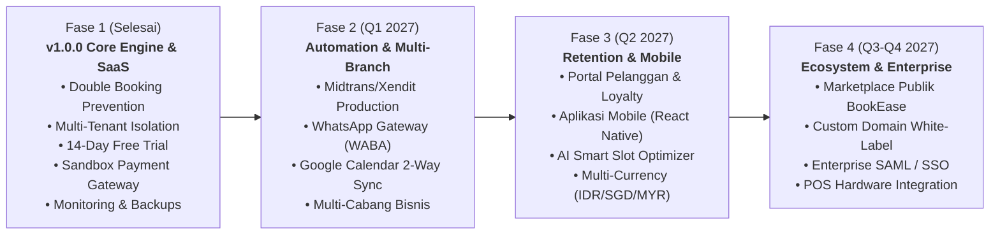

# Roadmap Pengembangan Produk (Product Roadmap) - BookEase

Dokumen ini memetakan visi evolusi dan peta jalan pengembangan platform **BookEase** dari rilis dasar v1.0.0 menuju platform manajemen reservasi jasa nomor satu di Asia Tenggara.

---

---

## Rincian Milestone Pengembangan

### 1. Fase 1: Fondasi Inti & SaaS Infrastructure (Telah Selesai — v1.0.0)
- [x] **Core Scheduling Engine**: Algoritma slot ketersediaan real-time dengan proteksi double-booking dan buffer time dinamis.
- [x] **Multi-Tenant Architecture**: Pemisahan logis antar workspace bisnis berbasis `businessId` dengan otentikasi sesi HMAC anti-tamper.
- [x] **Premium UI/UX Design**: Desain dashboard eksklusif, responsif, dan ramah pengguna dengan tema indigo modern.
- [x] **Model Bisnis SaaS**: Free Trial 14 hari otomatis, paket berlangganan Starter, Pro, Enterprise dengan penegakan kuota (*usage limits*).
- [x] **Sandbox Payment Gateway**: Alur checkout instan dan simulasi QRIS, Virtual Account, dan Kartu Kredit.
- [x] **Observability & Health Checks**: Structured JSON logger, APM latency histogram, probe `/api/health`, dan alerting engine.
- [x] **Keamanan & Backup**: Checksum SHA-256 untuk backup database, CSRF origin verification, dan perlindungan PII.

---

### 2. Fase 2: Otomatisasi Notifikasi & Ekspansi Cabang (Target: Q1 2027)
- [ ] **Aktivasi Gateway Produksi**:
  - Transisi dari Sandbox ke kredensial Production Midtrans Snap & Xendit Invoice.
- [ ] **Notifikasi WhatsApp Otomatis (WhatsApp Business API / WABA)**:
  - Mengirim pengingat janji temu 24 jam dan 2 jam sebelum jadwal langsung ke WhatsApp pelanggan untuk menekan angka *No-Show* hingga 80%.
- [ ] **Sinkronisasi 2-Arah Google Calendar**:
  - Mengintegrasikan jadwal staf langsung ke Google Calendar pribadi staf secara real-time.
- [ ] **Dukungan Multi-Cabang (Multi-Location Support)**:
  - Memungkinkan bisnis skala enterprise mengelola banyak lokasi cabang fisik dalam satu akun pusat.

---

### 3. Fase 3: Retensi Pelanggan & Aplikasi Mobile (Target: Q2 2027)
- [ ] **Portal Pelanggan & Program Loyalitas**:
  - Halaman login khusus pelanggan untuk melihat riwayat janji temu, unduh kuitansi, dan mengumpulkan poin reward loyalitas.
- [ ] **Aplikasi Mobile untuk Staf & Pemilik Bisnis (React Native / Expo)**:
  - Notifikasi push instan saat ada reservasi baru masuk, pemindaian QR check-in kehadiran di lokasi.
- [ ] **AI Smart Schedule Optimizer**:
  - Rekomendasi jadwal cerdas untuk memaksimalkan okupansi staf dan meminimalkan celah waktu kosong (*idle time*).
- [ ] **Dukungan Multi-Mata Uang**:
  - Ekspansi ke pasar regional Asia Tenggara (IDR, SGD, MYR, THB).

---

### 4. Fase 4: Ekosistem Marketplace & Solusi Enterprise (Target: Q3–Q4 2027)
- [ ] **BookEase Discovery Marketplace**:
  - Direktori agregator publik di mana pengguna dapat mencari salon, klinik, dan barbershop terdekat di kota mereka.
- [ ] **Custom Domain White-Label**:
  - Fitur bagi pengguna Enterprise untuk menggunakan domain sendiri (contoh: `booking.glowstudio.id`).
- [ ] **Enterprise Single Sign-On (SSO / SAML / Okta)**:
  - Kepatuhan standar keamanan korporasi dan audit trail terperinci.
- [ ] **Integrasi Perangkat Kasir (POS Hardware)**:
  - Terhubung dengan printer struk thermal Bluetooth dan mesin EDC pembayaran di kasir.
